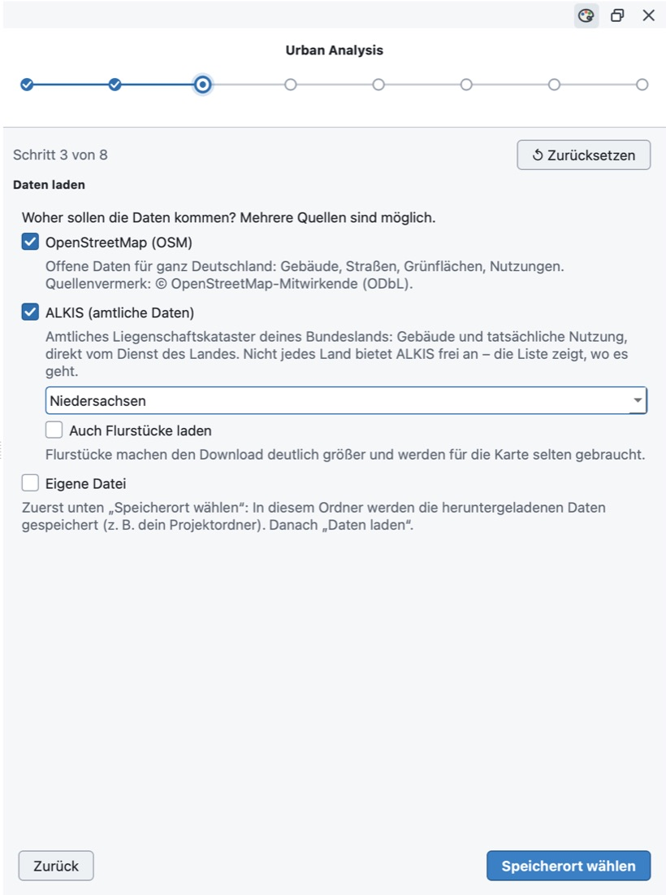
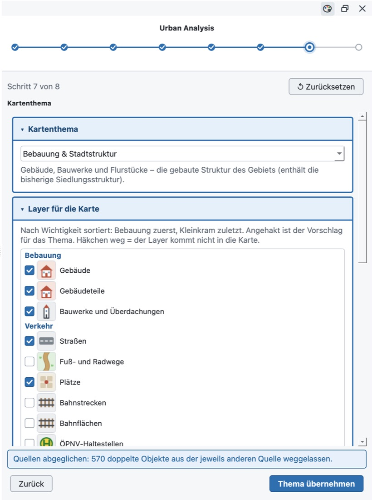
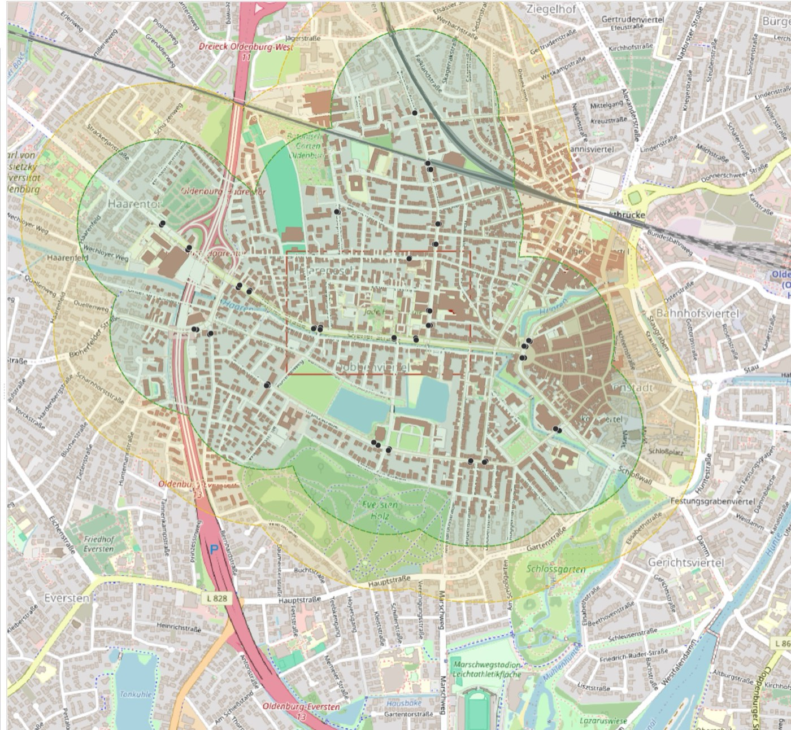
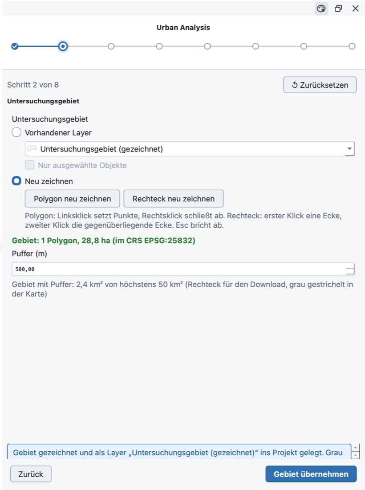
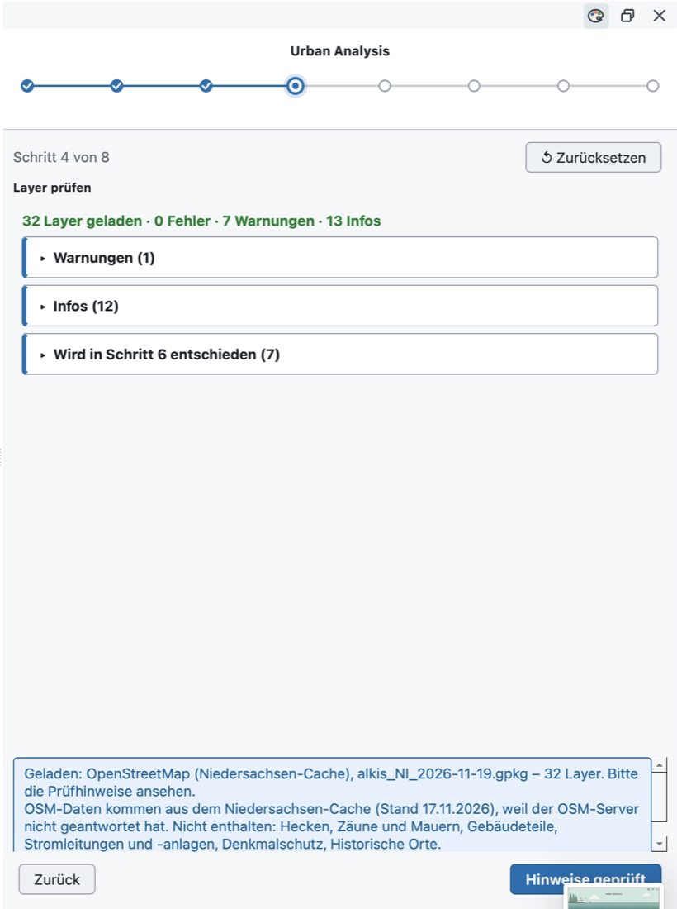
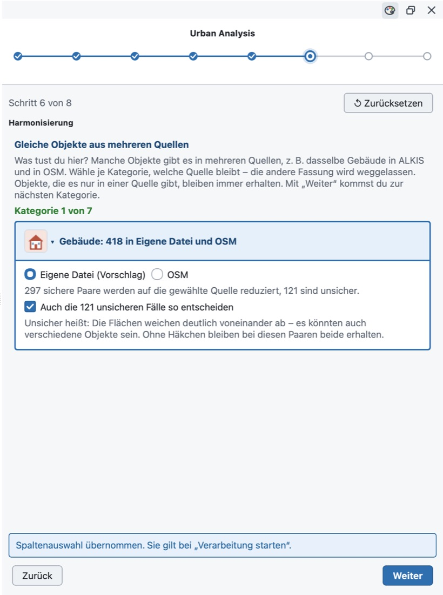
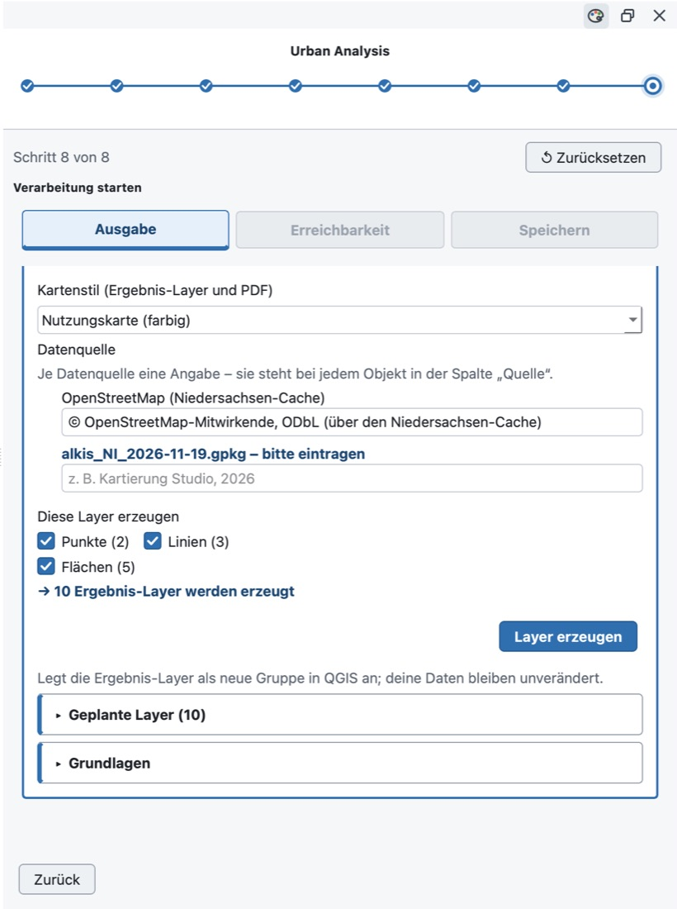
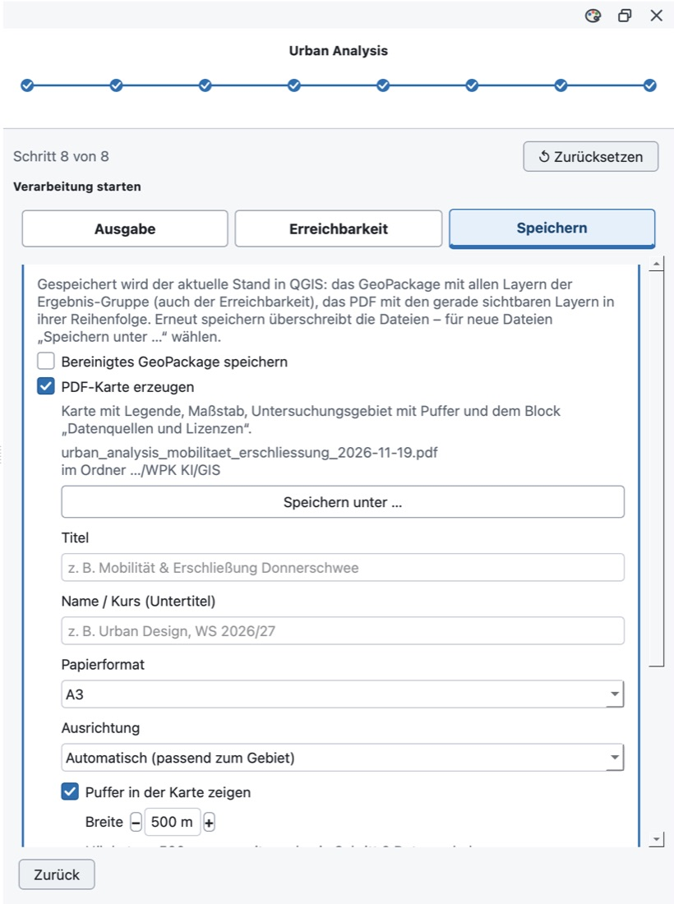
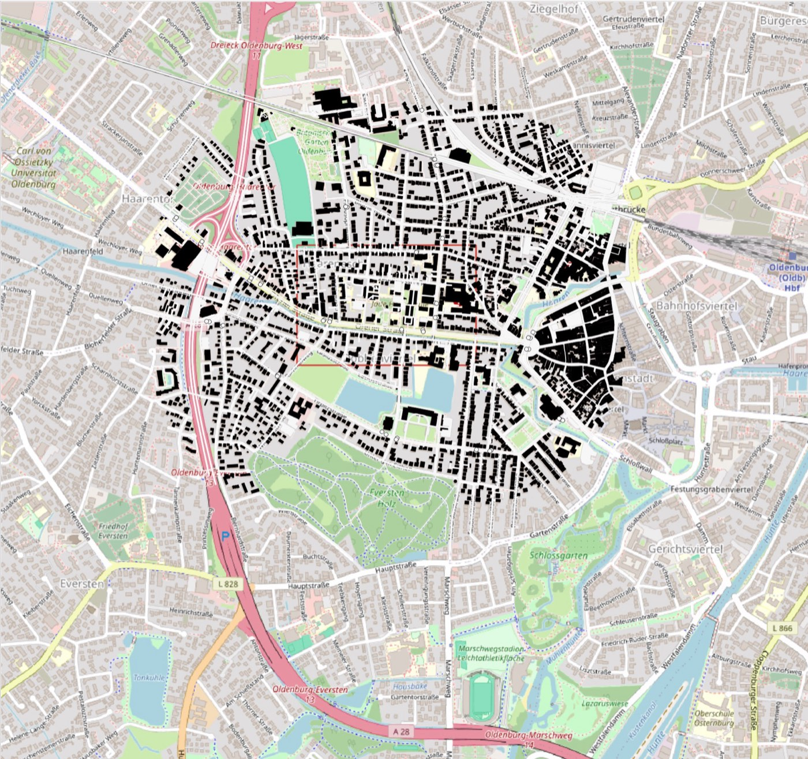

# Urban Analysis – QGIS-Plugin für städtebauliche Bestandsanalysen

Ein QGIS-Plugin, das Studierende Schritt für Schritt von der leeren Karte zu einer
sauberen Datengrundlage führt: Es lädt Daten für ein selbst gewähltes Gebiet
(OpenStreetMap, amtliches ALKIS oder eigene Dateien), führt sie zusammen, bereinigt
sie, prüft auf Dopplungen und erzeugt daraus geordnete Karten-Layer, eine
Erreichbarkeitsanalyse und ein PDF.

Entstanden im Wahlpflichtkurs „Thinking Architecture through Software Design —
Vibecoding KI Werkstatt“ an der Jade Hochschule, Fachbereich Architektur, Studiengang
Urban Design (Wintersemester 2026/27).

> **Stand:** experimentell (Version 0.1). Das Plugin funktioniert für ganz Deutschland,
> getestet wurde vor allem in Oldenburg (Niedersachsen).

**[⬇ Plugin herunterladen (ZIP)](https://github.com/Jade-HS-Vibecoding-WPK/urban-analysis-plugin/releases/latest/download/urban_analysis_plugin.zip)**
· **[Live-Demo ansehen](https://jade-hs-vibecoding-wpk.github.io/urban-analysis-plugin/)**

<p>
  
  
  
</p>

---

## Unser Anspruch: nah an den Daten, fachlich sauber

Das Plugin soll nichts „schöner rechnen“, als die Daten sind:

- **Rohdaten bleiben unverändert** – Ergebnisse entstehen als neue Layer und Dateien.
- **Nichts passiert still** – Fehler, Lücken und unsichere Fälle erscheinen als Hinweis,
  Vorschläge des Plugins gelten erst, wenn du sie bestätigst.
- **Dopplungen mit Augenmaß** – exakt gleiche Objekte werden entfernt, ähnliche nur
  angezeigt; du entscheidest.
- **Herkunft bleibt sichtbar** – jedes Objekt behält Quelle und Dateiname, kein Wert geht
  verloren.
- **Grenzen werden genannt** – was die Daten nicht zeigen, steht dabei; Unsicheres ist als
  „vermutlich“ markiert.

---

## Was das Plugin kann

### Der Ablauf in 8 Schritten

1. **Projekt-KBS** – Koordinatensystem in Metern wählen (z. B. EPSG:25832).
2. **Untersuchungsgebiet** – Fläche in QGIS wählen, ein Polygon zeichnen oder ein
   Rechteck mit zwei Klicks aufziehen; Puffer festlegen. Die Größe wird gleich angezeigt
   (Warnung ab 25 km², kein Download über 50 km²).
3. **Daten laden** – OpenStreetMap, ALKIS deines Bundeslands und/oder eigene Dateien,
   auch mehrere zugleich.
4. **Layer prüfen** – Was ist angekommen, was fehlt? Hinweise mit Erklärung.
5. **Attributzuordnung** – Vorschau der späteren Attributtabelle mit lesbaren
   Spaltennamen und Beispielwerten. „Essentielle“ Spalten (z. B. Objekt-ID, Kategorie)
   sind immer dabei; alle anderen: „Behalten“ oder „Nicht übernehmen“.
6. **Harmonisierung** – in zwei Teilen: erst gleiche Objekte aus mehreren Quellen
   (je Kategorie wählst du die Quelle, das Plugin schlägt eine vor), dann unsichere
   Dubletten.
7. **Kartenthema** – Thema aus der Liste wählen; die passenden Layer sind vorausgewählt
   und lassen sich einzeln an- und abwählen (siehe unten).
8. **Verarbeitung** – Ergebnis-Layer erzeugen, Erreichbarkeit berechnen, Quellenangabe
   je Datenquelle prüfen, speichern.

#### So sieht die Bedienung aus

| 2 · Gebiet wählen | 4 · Layer prüfen | 6 · Quellen abgleichen |
| :---: | :---: | :---: |
|  |  |  |
| **8 · Ausgabe** | **8 · Speichern** | **Ergebnis: Schwarzplan** |
|  |  |  |

Mehr Bilder, auch im Pixel-Stil, zeigt die [Live-Demo](https://jade-hs-vibecoding-wpk.github.io/urban-analysis-plugin/).

### Ergebnisse

- **Geordnete Ergebnis-Layer** in QGIS, je Kategorie ein Layer (z. B. ein Layer
  „Gebäude“ aus ALKIS und OSM zusammen), in Gruppen wie Bebauung, Verkehr,
  Grün & Wasser. Kleinkram wie Zäune liegt ausgeblendet unter „Sonstiges“.
- **Kartenstile:** Nutzungskarte (farbig), Schwarzplan, Graustufen (für Druck).
- **Erreichbarkeit:** Abstand jedes Gebäudes zum nächsten Ziel (z. B. Nahversorgung,
  Bildung, Haltestellen oder eigene Ziele), mit Ringen um die Ziele (Standard 300 m
  und 500 m).
- **PDF-Karte** von A4 bis A0 mit Legende, Nordpfeil, Maßstab und Quellen. Das Plugin
  schlägt einen passenden Maßstab für das Blattformat vor (z. B. „A3 quer: 1:5.000“);
  der Puffer lässt sich ein- und ausblenden.
- **GeoPackage** mit allen Ergebnis-Layern.

### Zwei Oberflächen-Stile

Über das Paletten-Symbol im Plugin-Fenster lässt sich jederzeit wechseln:

- **Klassisch** – hell und neutral wie QGIS selbst, mit blauem Akzent, QGIS-Schrift und
  gewohnten Bedienelementen. Oben zeigen Schrittpunkte und ein Ladebalken, wo du stehst.
- **Pixel** – verspielt, mit Einflüssen aus Spielen (Gamification): pastellige
  Pixel-Landschaft, ein angelnder Hase zieht beim Laden den Fortschritt heran, ein Fisch
  schwimmt zum aktuellen Schritt und beißt an, wenn etwas fertig ist. Alle Figuren sind
  selbst gezeichnet.

Beide Stile bieten dieselben Funktionen; der Kartenstil der Ergebnisse ist davon
unabhängig.

### Kartenthemen für Bestandsanalysen

Sieben allgemeine Themen, die zu jeder Analyseaufgabe und jedem Gebiet passen:

| Thema | Beispiele für Klassen |
| --- | --- |
| Bebauung & Stadtstruktur | Haupt- und Nebengebäude, Bauwerke, Brücken, Flurstücke; Stufen nach Geschosszahl |
| Nutzungen | Wohnen, Einzelhandel, Gastronomie, Dienstleistung, Gewerbe, öffentliche Einrichtungen, gemischt |
| Versorgung & soziale Infrastruktur | Nahversorgung, Gesundheit, Bildung und Betreuung, Kultur, Sport; Stufen nach Abstand |
| Freiraum & öffentlicher Raum | Plätze und Fußgängerzonen, Parks, Spielplätze, Sitzgelegenheiten, Uferzugänge |
| Mobilität & Erschließung | Straßen nach Rang, Fuß- und Radwege, Radverkehr an Straßen, Haltestellen, Querungen, Stellplätze |
| Grün, Wasser & Klima | Grünflächen, Wald, Gewässer, Bäume und Baumreihen, versiegelte Flächen (Näherung) |
| Geschichte & Stadtbild | Baudenkmale, Denkmäler, historische Orte, Aussichtspunkte, markante Gebäude |

- **Baukasten:** Je Thema sind passende Layer vorausgewählt (Gebäude und Straßen immer
  zur Orientierung); jeder Layer lässt sich an- und abwählen. Ein Objekt kann in
  mehreren Themen vorkommen – ein Café ist Nutzung und Treffpunkt.
- **OSM und ALKIS:** Die Zuordnung nutzt beide Quellen.
- **Ehrlich:** Je Thema steht dabei, was die Daten nicht zeigen (z. B. Leerstand,
  Aufenthaltsqualität), mit Tipps für bessere Daten. Fehlt eine Klasse im Gebiet, sagt
  ein Hinweis das. Unsichere Klassen sind als „vermutlich“ markiert.
- **Erweiterbar:** Themen und Klassen stehen als Katalog in
  `urban_analysis/topics_catalog.json` und lassen sich ohne Programmierung ergänzen.

---

## Installation

Voraussetzung: **QGIS 3.44 oder neuer** (Windows oder macOS).

1. Plugin-ZIP besorgen – **[hier herunterladen](https://github.com/Jade-HS-Vibecoding-WPK/urban-analysis-plugin/releases/latest/download/urban_analysis_plugin.zip)**
   (immer die neueste Version, nicht entpacken) oder im heruntergeladenen Repository
   selbst bauen:
   ```bash
   python build_plugin_zip.py
   ```
   Das Skript packt nur den Plugin-Code und bricht ab, falls versehentlich Daten,
   Passwörter oder persönliche Pfade enthalten wären.
2. In QGIS: **Erweiterungen → Erweiterungen verwalten und installieren → Aus ZIP
   installieren** und die ZIP-Datei wählen.
3. Weil das Plugin experimentell ist: unter **Einstellungen** „Auch experimentelle
   Erweiterungen anzeigen“ anhaken.
4. Das Plugin erscheint im Menü und in der Werkzeugleiste als **Urban Analysis**.

---

## Daten und Lizenzen

Das Plugin enthält **keine Geodaten**. Es lädt sie beim Benutzen für dein Gebiet herunter
oder liest deine eigenen Dateien. Heruntergeladene Daten landen in einem Ordner, den du
wählst.

### Was welcher Lizenz unterliegt

| Bestandteil | Lizenz |
| --- | --- |
| Plugin: Code, Kataloge (Quellen, Kategorien, Kartenthemen), Icons | [Apache License 2.0](LICENSE) |
| OpenStreetMap-Daten (über Overpass oder den Niedersachsen-Zwischenspeicher) | [ODbL 1.0](https://opendatacommons.org/licenses/odbl/1-0/) – Vermerk „© OpenStreetMap-Mitwirkende, ODbL“ |
| ALKIS-Daten | Lizenz des jeweiligen Bundeslands (Tabelle unten) |
| Eigene Dateien | die Lizenz deiner Daten – bitte im Feld „Datenquelle“ angeben |
| Deine Ergebnisse (Layer, GeoPackage, PDF) | die Lizenzen der darin enthaltenen Daten; aus OSM abgeleitete Daten bleiben unter der ODbL |

### ALKIS je Bundesland

| Land | Im Plugin | Lizenz | Quellenvermerk |
| --- | --- | --- | --- |
| Brandenburg | verfügbar | dl-de/by-2-0 | © GeoBasis-DE/LGB, dl-de/by-2-0 |
| Hamburg | verfügbar | dl-de/by-2-0 | © FHH, LGV, dl-de/by-2-0 |
| Hessen | verfügbar | dl-de/zero-2-0 | © HVBG |
| Mecklenburg-Vorpommern | verfügbar | CC BY 4.0 | © GeoBasis-DE/M-V ‹Jahr›, CC BY 4.0 |
| Niedersachsen | verfügbar | CC BY 4.0 | © GeoBasis-DE/LGLN ‹Jahr›, CC BY 4.0 |
| Nordrhein-Westfalen | verfügbar | dl-de/zero-2-0 | © GeoBasis NRW |
| Rheinland-Pfalz | verfügbar | dl-de/by-2-0 | © GeoBasis-DE / LVermGeoRP ‹Jahr›, dl-de/by-2-0 |
| Sachsen | verfügbar | dl-de/by-2-0 | © GeoSN, dl-de/by-2-0 |
| Schleswig-Holstein | verfügbar | CC BY 4.0 | © GeoBasis-DE/LVermGeo SH, CC BY 4.0 |
| Thüringen | verfügbar | CC BY 4.0 | © GDI-Th |
| Baden-Württemberg, Bayern, Berlin, Bremen, Saarland | kommt später | – | – |
| Sachsen-Anhalt | nicht frei abrufbar | – | – |

Lizenztexte: [CC BY 4.0](https://creativecommons.org/licenses/by/4.0/deed.de),
[dl-de/by-2-0](https://www.govdata.de/dl-de/by-2-0),
[dl-de/zero-2-0](https://www.govdata.de/dl-de/zero-2-0).

Die Quellenvermerke trägt das Plugin automatisch in die Attributtabelle (Spalte
„Datenquelle“) und ins PDF ein. **Bitte keine lizenzpflichtigen Daten weitergeben oder
veröffentlichen.**

---

## Grenzen und Hinweise

- **Erreichbarkeit ist Luftlinie.** Echte Fußwege sind meist 20–30 % länger; Ziele
  außerhalb des geladenen Gebiets fehlen, am Rand sind Abstände deshalb eher zu groß.
- **OSM ist unterschiedlich vollständig.** Geschosszahlen, Bänke oder Bäume fehlen oft;
  ALKIS ist bei Gebäuden meist vollständiger.
- **Deutung bleibt bei dir.** Raumkanten, Typologien, Aufenthaltsqualität, Sichtachsen
  oder Leerstand zeigen die Daten nicht.
- **Dienste können ausfallen.** Overpass ist zeitweise überlastet, ALKIS-Dienste haben
  Wartungszeiten. Das Plugin meldet das; eine eigene Datei ist dann der Ausweg.
- **Keine Umprojektion im Hintergrund.** Passt das Koordinatensystem einer Quelle nicht,
  wird das angezeigt statt still umgerechnet.

---

## Hinweis zur KI-Nutzung

Das Plugin ist in einem Kurs zum Programmieren mit KI entstanden. Code, Tests und Texte
wurden zu großen Teilen mit KI-Programmierassistenten (Claude Code, GitHub Copilot)
geschrieben – nach den Vorgaben des Teams. Fachliche Entscheidungen (was das Plugin
können soll, welche Daten wie behandelt werden) hat das Team getroffen; jede Änderung
wurde mit automatischen Tests und von Hand in QGIS geprüft.

Das Plugin selbst nutzt **keine KI** und sendet keine Daten an KI-Dienste. Es fragt nur
die genannten Datendienste ab (OpenStreetMap, ALKIS der Länder).

---

## Lizenz

Das Plugin steht unter der [Apache License 2.0](LICENSE). Für die Daten gelten die
Lizenzen der jeweiligen Quellen (siehe „Daten und Lizenzen“). Diese README ist keine
Rechtsberatung.
